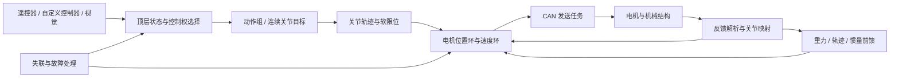
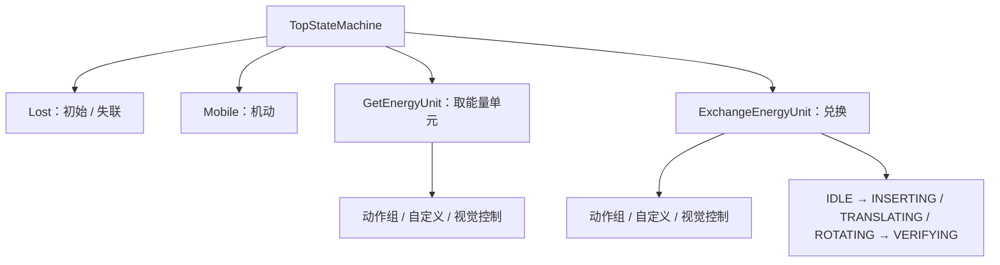

# RoboMaster Engineer 26｜七关节机械臂控制工程

面向 RoboMaster 工程机器人的 STM32F405 嵌入式控制工程，围绕七关节机械臂、夹爪、伸缩云台和底盘协同，组织动作组、人工控制、视觉控制与失联处理。

本文重点说明**重力补偿、位置/速度串级控制与前馈、分层有限状态机、通信解耦，以及关节轨迹插值**。公式按当前公开代码展开，阅读基线为 `2330c8a`；它们描述实现及建模假设，不代表所有参数已经完成实机辨识。

> **依赖说明：**公开仓库不包含实验室内部 SRML 源码。完整编译需要经授权取得兼容版本，并在本地恢复项目根目录下的 `SRML/`。请保留该目录的忽略规则，不要向公开仓库提交内部库或含库源码的旧历史。

## 导航

- [工程结构与控制链路](#architecture)
- [重力补偿：从势能到七关节实现](#gravity)
- [PID 与多种前馈](#control)
- [分层有限状态机](#hfsm)
- [通信与控制权处理](#communication)
- [轨迹插值规划](#trajectory)
- [编译、移植与验证](#build)

## 1. 工程结构与控制链路

平台为 STM32F405RGTx / Cortex-M4F，采用 STM32 HAL、FreeRTOS 和 Keil MDK / Arm Compiler 6。`configTICK_RATE_HZ=1000`；电机任务和状态机任务均以 `vTaskDelayUntil(..., 1)` 请求 1 ms 周期，这表示调度目标，不等同于已经测得的最坏执行时间保证。

| 层次 | 代码入口 | 主要职责 |
|---|---|---|
| 业务与控制权 | [StateMachine](USP/Application/StateMachine)、[Controller](USP/Application/Controller) | 机动、取能量单元、兑换、控制器切换 |
| 动作与关节 | [Move](USP/Application/Move)、[Joint](USP/Application/Joint_Space/Joint/Joint.cpp) | 路径点、规划器接管、关节软限位 |
| 执行器与电机 | [JointActuator](USP/Application/Actuators_Space/JointActuator/JointActuator.cpp)、[Motor](USP/Application/Actuators_Space/Motor/Motor.cpp) | 机械映射、模式、反馈、PID 和力矩合成 |
| 模型补偿 | [Compension.cpp](USP/Application/Compension/Compension.cpp) | 重力、摩擦、反电动势、J1 等效惯量计算 |
| 周期与通信 | [Service_Device.cpp](USP/Application/Service_Device.cpp)、[Service_Communication.cpp](USP/Application/Service_Communication.cpp) | 周期任务、故障处理、队列和中断接口 |

## 2. 重力补偿：从势能到七关节实现

### 2.1 坐标、角度和力矩符号

重力模型使用世界系 $z$ 向上，重力加速度向量为 $\mathbf g_0=[0,0,-g]^T$。俯仰以水平前伸为零、上仰为正，因此采用标准右手旋转矩阵的 $R_y(-\alpha)$。这里正的保持力矩用于抵消重力：

$$
U=\sum_k m_k g h_k,\qquad
\tau_{\mathrm{gravity},j}=-\frac{\partial U}{\partial\eta_j},\qquad
g_j(\eta)=\tau_{\mathrm{hold},j}=+\frac{\partial U}{\partial\eta_j}.
$$

`GravityCompension_Calculate()` 返回的是用于保持的补偿项。阅读旧注释时，应区分“重力本身的力矩”和“抵消重力的执行器力矩”，两者符号相反。

调用侧先通过 `MDH2Gravity_J*()` 转换关节角。令 $q_i$ 为代码中关节反馈角，$\eta_i$ 为补偿模型输入，当前转换为：

$$
(\eta_2,\eta_3,\eta_4,\eta_5,\eta_6,\eta_7)
=(q_2,-q_3,-q_4-90^\circ,-q_5,-q_6,-q_7).
$$

函数输入为度，进入三角函数前转换为弧度。下文求导均对**弧度**进行，并定义：

$$
\alpha_2=\eta_2,\quad
\alpha_3=\eta_2+\eta_3,\quad
\alpha_4=\eta_2+\eta_3+\eta_4,\quad
\phi_5=\eta_5,\quad\delta=\eta_6,\quad\phi_7=\eta_7.
$$

J1 为绕竖直轴的 yaw；理想重力模型中，单独改变 J1 不改变质心高度，所以 $g_1=0$。J5、J7 是 roll，仍可能因偏心负载产生重力矩。

### 2.2 为什么必须拆分腕部质量

| 质量体 | 代码参数 | 当前初值 / kg | 对应关节作用范围 |
|---|---|---:|---|
| 连杆 2，含 J3 电机 | `M2` | 0.846 | J2 |
| 连杆 3，含 J4 电机 | `M3` | 0.558 | J2～J3 |
| 连杆 4，含 J5 电机 | `M4` | 1.068 | J2～J4 |
| J6 输入侧质量 | `M_PRE_J6`，下记 $m_5$ | 0.490 | J2～J5 |
| J7 输入侧质量 | `M_PRE_J7`，下记 $m_6$ | 0.397 | J2～J6 |
| J7 输出件、夹爪及负载 | `M_POST_J7`，下记 $m_7$ | 1.072 | J2～J7 |

例如，J6 电机自身位于 J6 输入侧，不应再被计入 J6 输出侧的重力矩。把腕部全部质量合并到末端，会破坏这种支撑关系。

当前 $L_2=0.300\,\mathrm m$、$L_3=0.150\,\mathrm m$、$L_4=0.097\,\mathrm m$。质量、质心和部分长度在源码中仍带有估算或待标定说明，移植时应以实际 CAD、安装位置和负载替换。

### 2.3 平面俯仰链的推导

局部质心为 $c_i=[c_{ix},0,c_{iz}]^T$。经过上仰旋转：

$$
\begin{bmatrix}x_i\\z_i\end{bmatrix}
=\begin{bmatrix}\cos\alpha_i&-\sin\alpha_i\\
\sin\alpha_i&\cos\alpha_i\end{bmatrix}
\begin{bmatrix}c_{ix}\\c_{iz}\end{bmatrix}.
$$

于是：

$$
h_i=c_{ix}\sin\alpha_i+c_{iz}\cos\alpha_i,
\qquad A_i=\frac{\partial h_i}{\partial\alpha_i}
=c_{ix}\cos\alpha_i-c_{iz}\sin\alpha_i.
$$

$A_i$ 就是该质心的水平力臂。单个质心、水平杆且 $c_{iz}=0$ 时，结果退化为熟悉的 $\tau=mgc_{ix}\cos\alpha$。远端质量还需要累加前方连杆的高度，例如：

$$
h_3=L_2\sin\alpha_2+c_{3x}\sin\alpha_3+c_{3z}\cos\alpha_3.
$$

对 $\eta_2$ 求导时，$\alpha_2$ 与 $\alpha_3$ 都变化，因此 J2 必须承担整个后续链的重力贡献，不能只补偿本连杆。

### 2.4 腕部 roll–pitch–roll 的三维耦合

设腕部参考点高度为：

$$
h_o=L_2\sin\alpha_2+L_3\sin\alpha_3+L_4\sin\alpha_4.
$$

代码的三个局部质心分别是 `C5*`、`C6*`、`C7*`，其旋转链为：

$$
\begin{aligned}
r_5&=R_y(-\alpha_4)R_x(\phi_5)c_5,\\
r_6&=R_y(-\alpha_4)R_x(\phi_5)R_y(-\delta)c_6,\\
r_7&=R_y(-\alpha_4)R_x(\phi_5)R_y(-\delta)R_x(\phi_7)c_7.
\end{aligned}
$$

三组高度为 $h_o+H_k$，其中 $H_k=e_z^Tr_k$。这是当前腕部参考点/质心近似模型；并非根据任意机械结构自动生成的通用刚体链。

为对应源码中的 `c6_x5`、`c7_z4` 等中间量，对 $k=6,7$ 先取：

$$
(u_6,v_6,w_6)=c_6,\qquad
\begin{bmatrix}u_7\\v_7\\w_7\end{bmatrix}=R_x(\phi_7)c_7,
$$

$$
x_k=\cos\delta\,u_k-\sin\delta\,w_k,\quad
z_k=\sin\delta\,u_k+\cos\delta\,w_k,
$$

$$
H_k=\sin\alpha_4\,x_k+
\cos\alpha_4(\sin\phi_5\,v_k+\cos\phi_5\,z_k).
$$

对 $k=5$，直接令 $x_5=c_{5x},v_5=c_{5y},z_5=c_{5z}$，使用同一高度式，但它不依赖 $\delta$ 或 $\phi_7$。链式求导得到：

$$
\begin{aligned}
H_{k,\alpha}&=\cos\alpha_4\,x_k-\sin\alpha_4(\sin\phi_5v_k+\cos\phi_5z_k),\\
H_{k,5}&=\cos\alpha_4(\cos\phi_5v_k-\sin\phi_5z_k),\\
H_{k,6}&=-\sin\alpha_4z_k+\cos\alpha_4\cos\phi_5x_k\quad(k=6,7).
\end{aligned}
$$

由于 $\partial v_7/\partial\phi_7=-w_7$、$\partial w_7/\partial\phi_7=v_7$，还可得到：

$$
H_{7,7}=-\sin\alpha_4\sin\delta\,v_7+
\cos\alpha_4(-\sin\phi_5w_7+\cos\phi_5\cos\delta\,v_7).
$$

这解释了为什么腕部不应简单统一乘一个 $\cos\phi_5$：roll 会同时改变上游关节的有效力臂。

### 2.5 各关节补偿力矩与代码对应

记 $m_w=m_5+m_6+m_7$、$W_\alpha=\sum_{k=5}^7m_kH_{k,\alpha}$，并简记 $C_i=\cos\alpha_i$，则：

$$
\begin{aligned}
g_2/g={}&M_2A_2+M_3(L_2C_2+A_3)
+M_4(L_2C_2+L_3C_3+A_4)\\
&+m_w(L_2C_2+L_3C_3+L_4C_4)+W_\alpha,\\
g_3/g={}&M_3A_3+M_4(L_3C_3+A_4)
+m_w(L_3C_3+L_4C_4)+W_\alpha,\\
g_4/g={}&M_4A_4+m_wL_4C_4+W_\alpha,\\
g_5/g={}&m_5H_{5,5}+m_6H_{6,5}+m_7H_{7,5},\\
g_6/g={}&m_6H_{6,6}+m_7H_{7,6},\\
g_7/g={}&m_7H_{7,7}.
\end{aligned}
$$

它们分别对应 `GravityCompension_Calculate()` 的 `tau_J2`～`tau_J7`。电机任务读取实际关节反馈、进行 `MDH2Gravity_*` 转换，再将结果乘以当前控制模式的增益，调用 `motor[].setGravity_feedforward()`。

跨坐标传递力矩应满足虚功关系：若 $\eta=f(q)$，则 $g_q=(\partial\eta/\partial q)^Tg_\eta$。当前工程的方向、安装零点和电机侧注入还涉及关节映射与带符号增益，不能把模型输出不加换算地用于另一套硬件。控制器模式使用 `gravity_J2`～`gravity_J7`，其他模式使用 `NON_CONTROLLER_GRAVITY_GAIN`，两组参数须分别核对。

## 3. PID 与多种前馈

### 3.1 串级位置环和速度环

[Motor::execute()](USP/Application/Actuators_Space/Motor/Motor.cpp) 在角度模式下执行：

$$
\begin{aligned}
e_\theta&=\theta_d-\theta,\\
\omega_{\mathrm{ref}}&=\mathrm{PID}_{\theta}(e_\theta,\omega_{\mathrm{meas}})
+k_v\omega_{\mathrm{traj}},\\
\tau_{\mathrm{fb}}&=K_{p,\omega}(\omega_{\mathrm{ref}}-\omega_{\mathrm{meas}}),\\
\tau_{\mathrm{cmd}}&=\operatorname{sat}\big(
\tau_{\mathrm{fb}}+\tau_g+\tau_{\mathrm{emf}}+\tau_c+\tau_v
+\tau_I+\tau_{a,\mathrm{traj}}\big).
\end{aligned}
$$

位置环支持 PID，微分入口使用测得速度；**当前速度环配置实际为 P 控制**，`setPidParameters()` 将速度环 I、D 置零。PID 的离散积分和微分细节由外部依赖提供，这里只说明公开的调用与合成关系。总力矩在前馈相加后再次按 `v_pid.Out_Max` 限幅；力矩模式则直接下发目标力矩，不走这条角度模式合成链。

### 3.2 前馈项的意义与实际启用状态

| 前馈 | 模型/注入位置 | 当前公开实现 |
|---|---|---|
| 重力 | $\tau_g=g(q)$，力矩级 | J2～J7 主控制链中计算并按模式增益注入 |
| 速度 | $k_v\omega_d$，加到速度环目标 | 取能量单元/兑换控制中由轨迹导数计算 |
| 加速度 | $k_a\dot\omega_d$，力矩级 | `acc_ff_gain[]` 逐关节设置；部分轴增益为零 |
| 反电动势等效项 | $k_e^{\mathrm{eq}}\omega$，力矩级 | 接口已接入，但 `Compension.cpp` 内系数全为零 |
| 库仑摩擦 | $\tau_c=F_c\operatorname{sgn}(\omega)$ | 接口已接入，系数全为零；零速时返回零 |
| 黏性摩擦 | $\tau_v=B\omega$ | 接口已接入，系数全为零 |
| J1 惯量 | $\tau_I=I_{\mathrm{eq}}(q)\alpha_1$ | 模型及调用存在，但 `inertia_J1=0`，默认不产生最终输出 |

反电动势来源于电气关系 $u=Ri+L\dot i+K_e\omega$、$\tau=K_ti$。本工程最终给驱动器的是力矩命令，因此 `BackEMF` 是待辨识的**等效力矩级修正接口**，不能将电压常数 $K_e$ 原值直接加到 N·m 上。

轨迹输出使用 deg/s、deg/s²，电机侧使用 rad/s、rad/s²。若关节映射为 $q=k\theta_m+b$，则：

$$
\omega_{m,d}=\frac{\dot q_d}{k}\frac{\pi}{180},\qquad
\alpha_{m,d}=\frac{\ddot q_d}{k}\frac{\pi}{180}.
$$

对应实现位于 `GetEnergyUnit.cpp` 和 `ExchangeEnergyUnit.cpp`。前者还对接管时的前馈进行平滑和变化约束；模式退出、失联或对应电机故障时清理旧前馈，避免下一模式沿用旧轨迹导数。

### 3.3 J1 姿态相关惯量

由转动动能 $E_k=\tfrac12I_{\mathrm{eq}}\omega_1^2$ 和平行轴定理：

$$
I_{\mathrm{eq}}=I_{\mathrm{base}}+
\sum_i\left[m_i(x_i^2+y_i^2)+e_z^TR_iI_{c,i}R_i^Te_z\right].
$$

对于 $R_y(-\alpha)$ 和含 $I_{xz}$ 的局部惯性张量，转动投影为：

$$
I_{\mathrm{rot}}=I_{xx}\sin^2\alpha+I_{zz}\cos^2\alpha
+2I_{xz}\sin\alpha\cos\alpha.
$$

代码再取 $\tau_I=I_{\mathrm{eq}}\alpha_1$。这是一轴近似补偿，不等同于完整 $M(q)\ddot q+C(q,\dot q)\dot q$；惯量模块还使用独立的腕部等效参数，不能直接与重力模块的三组质量混用。

调用侧在轨迹加速度绝对值大于阈值时使用轨迹目标，否则回退到速度差分加低通的估计值。`EstimateJ1Acceleration()` 有内部状态，每周期只应更新一次；零目标加速度也可能走回退分支。惯量函数另有 $0.05\,\mathrm{rad/s^2}$ 加速度死区，最终仍乘 `inertia_J1`。验证模式 `ENABLE_J1_INERTIA_VALIDATION` 默认关闭。

## 4. 分层有限状态机

上层选择任务，下层选择任务内控制方式和执行阶段，避免把业务分支散落到电机输出代码中。

[TopState.cpp](USP/Application/StateMachine/TopState.cpp) 注册四个顶层子状态，初始为 `Lost`。当前快捷键包括 `Ctrl+B` 机动、`Ctrl+Z` 取能量单元、`Ctrl+V` 兑换；遥控链路失效时生成 `ToLost`。取物/兑换内部的控制模式与阶段主要由局部枚举和处理函数组织，并非图中每个节点都注册为 `hfsm::State_t` 对象。

[hfsm.h](USP/Middlewares/StateMachine_Kit/hfsm.h) 提供 `enter/action/exit` 回调与子状态转移。父状态先处理事件，再驱动子状态；当前实现依据**事件指针变化**判断是否发起转移，因此连续保持同一事件不会每个周期重新进入状态。周期动作应保持非阻塞，进入/退出动作负责模式、控制器和缓存的交接。

`Lost_enterAction()` 与持续动作都会调用 `ArmSafety_Trip()`；退出 Lost 不直接使能，由电机状态检查在链路恢复后解除锁存。单个电机故障则隔离对应电机并进行清错/启动，不以“全体都正常”作为其余关节继续工作的必要条件。兑换代码中注释掉的完成、失败和自动重试分支，不应视为已经完整启用的自动流程。

## 5. 通信与控制权处理

### 5.1 中断接收与业务处理解耦

- **CAN1/CAN2：**接收中断使用 `xQueueSendFromISR()` 投递，接收任务进行设备分发；发送任务读取队列，邮箱完成中断通过任务通知更新可用邮箱。
- **UART：**串口回调投递接收描述，任务内解析遥控器、裁判系统与底盘板数据，避免在中断中运行控制流程。
- **USB CDC 视觉链路：**回调仅把字节写入静态 StreamBuffer；任务重组候选帧、校验 CRC、发布深度为 1 的最新帧队列；状态机任务解码并独占更新 `reVisiondata`。

这种“字节流 → 合法帧快照 → 业务控制”的边界，使 USB 分包/粘包不会被误当成协议边界，控制任务也不会读取半更新的结构体。

### 5.2 视觉帧格式

见 [VisualCom.h](USP/Application/Communication/VisualCom.h) 与 [VisualCom.cpp](USP/Application/Communication/VisualCom.cpp)。当前收发结构均以 1 字节对齐，固定为 **67 字节**：

| 字段 | 字节数 | 含义 |
|---|---:|---|
| `FE EE` | 2 | 帧头 |
| `seq_num` | 2 | 序号，little-endian |
| `comm_flag` | 1 | 控制状态或业务命令/反馈，须按枚举解释 |
| `joint_current/target[7]` | 28 | 七轴 float 数据 |
| `torque_current/target[7]` | 28 | 七轴 float 数据 |
| `chassis_height_current/target` | 4 | 底盘高度 |
| `crc_code` | 2 | CRC16，低字节在前 |

CRC 初值 `0xFFFF`，逐位右移多项式 `0xA001`，覆盖帧头及 payload，不包含末尾 CRC 两字节。发送端应约定 IEEE-754 32 位 float 和相同字段顺序，不能直接依赖上位机语言的默认内存布局。

错误候选帧会在已有缓冲区中重新寻找帧头，并保留可能跨包的 `0xFE`；统计候选帧、CRC 错误和丢弃字节。底盘板串口采用自己的帧结构与 CRC 入口，不能直接复用视觉帧格式。

### 5.3 数据有效不等于拥有控制权

取物视觉模式有约 100 ms 的链路超时判断，以及显式的开始操作、允许命令位图、等待反馈和状态推进。进入模式后，按 Z 开始前不会仅因收到合法位置帧就接受上位机的关节位置控制。命令请求还带有代次，避免相同命令值被错误地当作旧请求。

`seq_num` 和 CRC 用于协议处理与诊断；这里不将其描述为已经实现可靠重传或防重放协议。动作组、自定义控制和视觉控制必须通过模式切换交接控制权，而不是同时写关节目标。

## 6. 轨迹插值规划

### 6.1 从动作组到周期目标

[System_DataPool.cpp](USP/Application/System_DataPool.cpp) 为七个关节分别创建 `TrajectoryPlanning(new CQC())`。动作组提供角度与段时长，`TrajectoryPointArray::add(dt, q)` 将**增量时长**累积为时间戳。规划器从起始目标插值，`Joint::takeOver()` 每周期采样、裁剪关节软限位，再反向映射到执行器角度。

当前关节启动规划需要角度模式且完成标定；规划有固定容量，路径数据应先检查时长、容量与软限位。轨迹插值只解决给定路径点的平滑连接，不等于避障、碰撞检测或时间最优规划。

### 6.2 CQC：三次—五次—三次

公开实现见 [cqc.h](USP/Application/Joint_Space/Traj/cqc.h)。每段总时长 $T$ 分为：

$$
h_c=0.15T,\qquad h_q=0.70T,\qquad h_c=0.15T.
$$

首尾用三次多项式调整速度，中部用五次多项式连接两端的位置、速度和加速度边界。设相邻路径点割线速度为 $s_i=(q_{i+1}-q_i)/T_i$，节点速度 $v_i$ 的选择为：

$$
v_0=v_n=0,\qquad
v_i=\begin{cases}
0,&\text{运动方向变化或分母接近零},\\
\dfrac{2s_{i-1}s_i}{s_{i-1}+s_i},&\text{同向段}.
\end{cases}
$$

对某段，代码令 $v_a=(2v_i+s_i)/3$、$v_b=(2v_{i+1}+s_i)/3$。前三次段满足初始位置、速度、零加速度和结束速度，因此：

$$
p_c(t)=q_i+v_it+\frac{v_a-v_i}{3h_c^2}t^3.
$$

中间五次段写为 $p(t)=\sum_{k=0}^5c_kt^k$。由起终点 $(p_0,v_0,a_0)$、$(p_1,v_1,a_1)$ 六个边界条件，有：

$$
\begin{aligned}
c_0&=p_0,\quad c_1=v_0,\quad c_2=a_0/2,\\
c_3&=\frac{20(p_1-p_0)-(12v_0+8v_1)h-(3a_0-a_1)h^2}{2h^3},\\
c_4&=\frac{-30(p_1-p_0)+(16v_0+14v_1)h+(3a_0-2a_1)h^2}{2h^4},\\
c_5&=\frac{12(p_1-p_0)-6(v_0+v_1)h-(a_0-a_1)h^2}{2h^5}.
\end{aligned}
$$

将前三次段末端、后三次段起点的边界代入，就得到源码 `quintic_a`～`quintic_f` 的形式。位置用 Horner 法采样，速度和加速度来自同一多项式的解析导数：

$$
\dot p=\sum_{k=1}^5kc_kt^{k-1},\qquad
\ddot p=\sum_{k=2}^5k(k-1)c_kt^{k-2}.
$$

`getDerivative()` 使用局部段索引，不推进主采样器状态，供速度前馈、加速度前馈和 J1 惯量项读取。实现按局部边界构造平滑连接，但其接口注释只承诺 C¹；使用加速度前馈时仍需考虑段界、采样与滤波，也没有全路径速度/加速度/jerk 约束求解器。

## 7. 编译、移植与验证

1. 经授权在本地准备兼容的 SRML，保持公开仓库的 `/SRML/` 忽略规则。
2. 使用 Keil MDK 打开 [MDK-ARM/Template.uvprojx](MDK-ARM/Template.uvprojx)，安装匹配的 STM32F4 设备支持包，使用工程指定的 AC6/FPU 设置。
3. 核对 CAN 电机 ID、反馈单位、关节方向、安装零点、减速比和软限位，再核对质量、质心、惯量与负载。
4. 先验证单轴方向和失能行为，再检查静态重力保持，最后逐项加入轨迹速度/加速度前馈。当前为零的补偿系数不应在未辨识时直接启用。
5. 对轨迹记录 $q_d,q,\dot q_d,\dot q,\tau_{\mathrm{fb}},\tau_{\mathrm{ff}}$ 与限幅情况；对通信记录 CRC、丢字节、超时与状态切换，区分模型误差、饱和和链路延迟。

重力推导可用势能有限差分复核：

$$
g_j(\eta)\approx\frac{U(\eta+\varepsilon e_j)-U(\eta-\varepsilon e_j)}{2\varepsilon}.
$$

建议覆盖水平、竖直、J5 roll 接近 $90^\circ$、J6 改变和 J7 偏心姿态，检查单位与符号，而不仅比较某一个姿态的保持效果。

## 8. 阅读入口

- 重力、惯量与摩擦：[Compension.h](USP/Application/Compension/Compension.h)、[Compension.cpp](USP/Application/Compension/Compension.cpp)。
- 控制与前馈增益：[Motor.cpp](USP/Application/Actuators_Space/Motor/Motor.cpp)、[System_DataPool.cpp](USP/Application/System_DataPool.cpp)。
- 业务控制：[GetEnergyUnit.cpp](USP/Application/StateMachine/GetEnergyUnit.cpp)、[ExchangeEnergyUnit.cpp](USP/Application/StateMachine/ExchangeEnergyUnit.cpp)。
- 原有模板说明已保留于 [docs/legacy-template-guide.md](docs/legacy-template-guide.md)，其中内部依赖获取步骤须服从本仓库的公开边界。
- 理论补充：[Modern Robotics：拉格朗日动力学](https://modernrobotics.northwestern.edu/nu-gm-book-resource/chapter-8-1-lagrangian-formulation-of-dynamics-part-1-of-2/)。本文参数与实际调用关系以本仓库源码为准。
